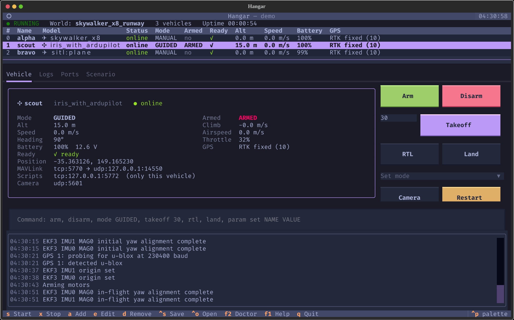
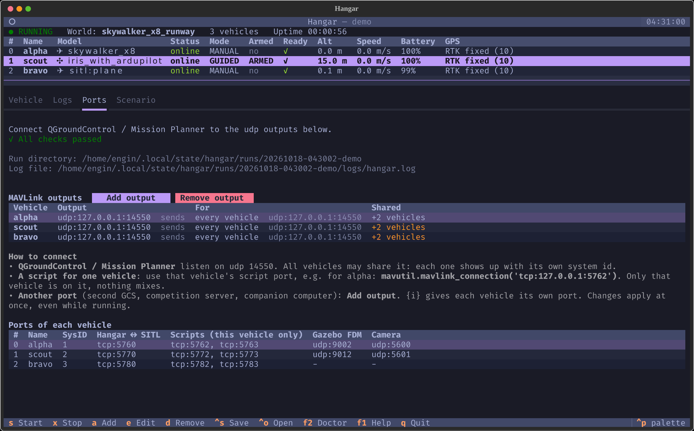
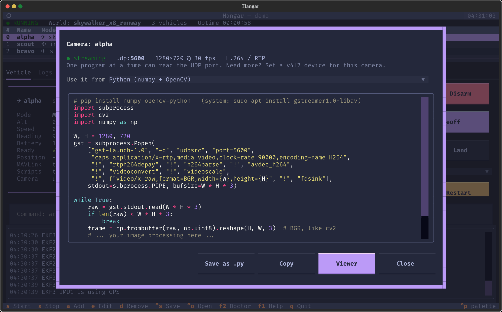
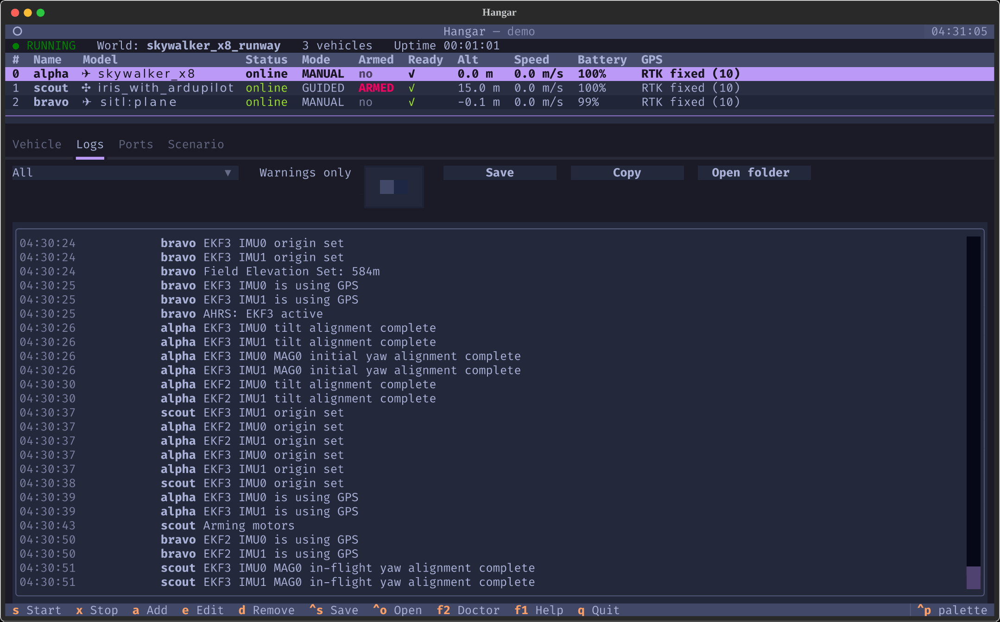
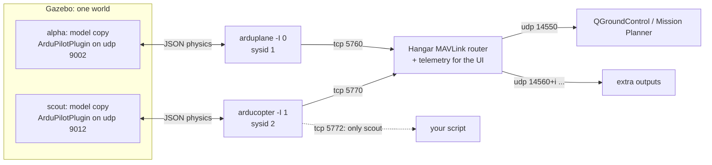
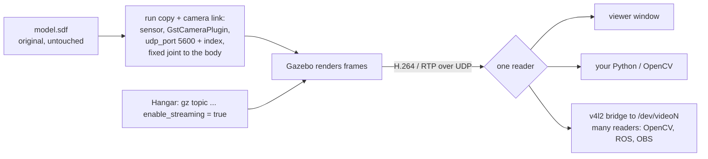

# Hangar

**Multi-vehicle ArduPilot SITL + Gazebo from one terminal.**

Hangar starts any number of ArduPilot vehicles (planes, copters, VTOLs, rovers,
boats) in Gazebo or with ArduPilot's built-in physics. It routes their MAVLink
to your ground station and shows the whole fleet in one terminal UI. A single
port plan covers every vehicle, and Hangar never opens a pile of terminal
windows.



<sub>Three vehicles in one terminal: a Gazebo plane with a nose camera, a Gazebo copter hovering at 15 m with a down-looking camera, and a plane with ArduPilot's built-in physics.</sub>

[Türkçe README](README.tr.md)

## Screenshots

| Ports: outputs, sharing, per-vehicle script ports | Camera: stream status and ready-to-paste code |
|---|---|
|  |  |
| **Logs: every vehicle's messages, filter, save, copy** | **What the plane's nose camera sees (OpenCV frame)** |
|  |  |

## Why

The usual multi-vehicle setup runs `sim_vehicle.py` once per vehicle, adds a
MAVProxy per vehicle, and opens one more window for the map. That means hard-coded
paths, `sleep`s, and ports scattered across scripts. Hangar replaces all of it with:

- **One scenario file**: world, vehicles, poses, parameters and outputs in YAML.
- **One port plan**: every port (SITL, Gazebo FDM, cameras, GCS outputs) is
  computed in one place and checked for conflicts before anything starts.
  `hangar ports` shows the plan.
- **One process**: SITLs run in the background with their logs in files. A
  built-in MAVLink router replaces the per-vehicle MAVProxies. Stopping always
  cleans up, so no SITL keeps running after you quit.
- **One terminal UI** that stays responsive while everything starts.

## Install

Linux, tested on Ubuntu 24.04 (x86_64). Other systems: see [Supported systems](#supported-systems).

```bash
curl -fsSL https://raw.githubusercontent.com/Enginar140/hangar/main/install.sh | bash
```

The installer asks before each step:

1. installs [uv](https://docs.astral.sh/uv/) and Hangar for your user (no sudo, and the system Python is left alone),
2. downloads ArduPilot's **official prebuilt SITL** (arducopter, arduplane, ardurover 4.7.2, about 21 MB,
   seconds, no compiler); `--build-ardupilot` builds from source instead,
3. installs a clipboard tool (wl-clipboard, xclip) for the Copy buttons,
4. optionally installs Gazebo Harmonic, the ArduPilot Gazebo plugin and example models,
5. runs `hangar doctor`.

Already have ArduPilot? Point Hangar at it instead:

```bash
uv tool install git+https://github.com/Enginar140/hangar
hangar config set ardupilot.dir ~/ardupilot
hangar config add catalog.model_paths ~/SITL_Models/Gazebo/models
hangar config add catalog.world_paths ~/SITL_Models/Gazebo/worlds
hangar config add gazebo.plugin_paths ~/ardupilot_gazebo/build
hangar doctor
```

### Licenses of what gets downloaded

Hangar is MIT-licensed and contains only its own code. ArduPilot (GPL-3.0),
ardupilot_gazebo (LGPL-3.0) and SITL_Models (no license stated) are **not**
bundled. `hangar sources fetch` shows each project's license and asks before
downloading it at a pinned version from its own upstream server
(firmware.ardupilot.org for the prebuilt SITL, GitHub for the rest), so you
get it directly from upstream. `hangar sources` lists what is installed, and the exact commits
are recorded in `~/.local/share/hangar/sources/lock.json`.

## Use

```bash
hangar                         # terminal UI (restores your last scenario)
hangar init                    # write quickstart.yaml (two vehicles, no Gazebo needed)
hangar quickstart.yaml         # open it in the UI
hangar up quickstart.yaml      # run without the UI, Ctrl+C stops
hangar ports quickstart.yaml   # port plan + preflight checks
hangar models / hangar worlds  # what can be launched
hangar doctor                  # what is installed, what is missing, how to fix it
hangar logs                    # log of the latest run   (-f follow, -w warnings only, --list runs)
```

### When vehicles take long to become ready

ArduPilot needs some seconds of *simulated* time (EKF, GPS lock) before it
can arm. The status bar shows the **sim speed** (×1 = real time). At ×0.05 a
20 s warm-up takes about 7 minutes. Before starting, Hangar warns about the
usual causes: rendering on an integrated GPU (use `headless: true`), big or
fast cameras (each frame is rendered and H.264-encoded on the CPU; 1280x720 at
30 fps is usually enough) and worlds with thousands of colliding buildings.
If a run stays below ×0.5, Hangar logs a warning naming these causes.

### Logs

Every run writes everything the UI shows (Hangar's events and every vehicle's
MAVLink messages, such as PreArm failures and mode changes) to
`~/.local/state/hangar/runs/<run>/logs/hangar.log`. Each SITL and Gazebo also
has its own raw log next to it. `runs/latest` always points to the newest run.
The Logs tab can **Save** the view with its current filter to a file,
**Copy** it, or **Open the run folder**. From a shell, use
`hangar logs -f` (follow), `hangar logs -w` (warnings only) or
`hangar logs --file plane/sitl.log`.

### Terminal UI keys

| Key | Action | Key | Action |
|---|---|---|---|
| `s` | start | `x` | stop |
| `a` | add vehicle | `e` / `d` | edit / remove vehicle |
| `1`–`4` | Vehicle / Logs / Ports / Scenario tab | `:` | command line for the selected vehicle |
| `ctrl+s` / `ctrl+o` | save / open scenario | `F2` | doctor |
| `m` | shared map (MAVProxy) | `ctrl+p` | command palette (themes too) |
| `q` | quit (stops the simulation) | | |

Vehicle commands (buttons or command line): `arm [force]`, `disarm`, `mode GUIDED`
(or just `GUIDED`), `takeoff 30`, `rtl`, `land`, `goto LAT LON [ALT]`, `param set NAME VALUE`,
`param get NAME`, `param fetch`, and `!<MAVProxy command>` while the map is open.

The UI is available in English and Turkish and follows `$LANG`. You can also
pick a language with `hangar config set language tr`.

## Scenario files

```yaml
name: two-planes
world: skywalker_x8_runway        # omit for built-in physics only
speedup: 1
first_instance: 0                 # raise it to run next to another SITL (ports move 10 per instance)
outputs:                          # every vehicle gets these
  - udp:127.0.0.1:14550           # QGroundControl / Mission Planner
  - udp:127.0.0.1:{15000+i}       # one port per vehicle; {i} = index, {sysid} = MAVLink id
vehicles:
  - model: skywalker_x8
    pose: [0, 0, 0.3, 0, 0, 90]   # x y z roll pitch yaw (m, deg); [x, y, z, yaw] also works
    camera:
      v4l2_device: /dev/video2    # nose camera -> cv2.VideoCapture('/dev/video2')
  - model: sitl:copter            # built-in physics, no Gazebo
    name: scout
    pose: [40, 0, 0]
    params: {SIM_WIND_SPD: 3}
    outputs: ["tcpin:0.0.0.0:{6000+i}"]
```

A vehicle without a `pose` is placed automatically: such vehicles are lined
up 15 m apart, clear of the ones that have a pose, so two vehicles never start
on the same spot.

### Cameras

Any Gazebo vehicle can have a camera, even if its model ships without one.
`camera: true` adds a camera to that run's copy of the model (the original
files stay untouched) and streams H.264 over RTP/UDP. Every key is optional:

```yaml
    camera:
      pose: [0, 0, -0.05, 0, 90, 0]   # on the body, m/deg; pitch 90 looks down (default: the nose, looking ahead)
      width: 1280
      height: 720
      fov: 60                         # horizontal, degrees
      fps: 30
      v4l2_device: /dev/video2        # optional: readable by OpenCV/ROS like a webcam
```

A model that already has a camera keeps it, and `camera: false` switches it off.
In the UI, the vehicle dialog sets the quality (low/medium/high/custom
resolution), FPS, field of view and direction. The encoder bitrate is fixed at
800 kbit/s by ArduPilot's camera plugin.

**Streaming to other devices.** A camera can send its stream to other
machines on the network, such as a Jetson running your vision code or a
laptop with QGroundControl. There are two modes:

```yaml
    camera:
      stream: relay                     # default: Hangar copies the stream
      outputs: ["10.205.218.120:5600", "192.168.1.50:{5600+i}", "239.0.0.1:5600"]
```

- `relay` (default): the camera sends to Hangar, which copies every packet,
  untouched, to this computer (`udp 5600 + index`) **and** every address in
  `outputs`. There is no re-encoding, so nothing is added to latency or lost in
  quality. Outputs can be added and removed in the Ports tab (**Camera
  outputs**) while running.
- `direct`: the camera plugin sends straight to its one address in `outputs`,
  with no relay in between, but this computer gets nothing. Changes apply on
  the next start.

A multicast address (`239.x.x.x`) reaches every device on the network at once.
On the receiving side, QGroundControl shows it under Video › UDP h.264 with
the port, and the code from the Camera window works there with that port. The
receiver's firewall must allow the port, e.g. `sudo ufw allow 5600/udp`. The
stream is not encrypted.

**Using the camera from Python.** The Camera button opens a window with
ready-to-paste code for that camera's port: Python with numpy/OpenCV, OpenCV's
GStreamer backend, the v4l2 device, or a `gst-launch` command. It can also save
the code as a `.py` file. A standalone version is in
[`examples/camera_opencv.py`](examples/camera_opencv.py):

```python
from camera_opencv import frames           # examples/camera_opencv.py
for frame in frames(port=5600, width=1280, height=720):
    ...                                     # frame: BGR numpy array, like cv2
```

It works with pip's `opencv-python`, which has no GStreamer support of its own.

**On another computer, Windows included:** run
[`examples/camera_check.py`](examples/camera_check.py) with `pip install opencv-python`
and `python camera_check.py 5600`. It first checks that packets arrive. If
they don't, it lists the usual causes: wrong IP, firewall, a "Public"
Windows network. It then shows the picture through OpenCV's FFmpeg with an
SDP file, so no GStreamer is needed.
Only one program can read a UDP port at a time. If several programs need the
same camera, give it a `v4l2_device` and open that device with
`cv2.VideoCapture('/dev/video2')`.

### Shared map (MAVProxy)

The **Map** button (or `m`) opens MAVProxy's map and console with **every
vehicle on one map**. Hangar finds a free port, adds it as a temporary output
to every vehicle, and starts MAVProxy on it. Closing the map, or stopping the
simulation, removes both, so the map needs no port settings. In the command
line, anything starting with `!` goes to MAVProxy for the selected vehicle,
e.g. `!wp list` or `!fence list`. MAVProxy's answers appear in the Logs tab.
Headless: `hangar up scenario.yaml --map`.

MAVProxy is optional. The first time you press Map, Hangar offers to install
it into its own folder (about 900 MB for wxPython and OpenCV, no sudo; GPL-3.0).
You can also run `hangar sources fetch mavproxy` or `install.sh --mavproxy`. A
ready-made wxPython exists for Ubuntu 22.04/24.04 on x86_64. Elsewhere, install
MAVProxy yourself and Hangar uses `mavproxy.py` from your PATH.

### Ports: connecting ground stations and scripts

All port settings live in the **Ports** tab. **Add output** and **Remove output**
work while the simulation runs, and changes apply immediately. The dialog
previews each vehicle's resulting port and refuses conflicts.

- **QGroundControl / Mission Planner** listen on udp 14550. All vehicles share
  it by default, which these programs handle: each vehicle shows up under its
  own system id.
- **A script for one vehicle** connects to that vehicle's own script port,
  `tcp:127.0.0.1:5762 + 10*i`. Nothing else talks on that port, so vehicles
  never mix. See [`examples/mavlink_script.py`](examples/mavlink_script.py):
  `mavutil.mavlink_connection('tcp:127.0.0.1:5762')`.
- **Another port** (a second GCS, a competition server, a companion computer):
  add an output. `{i}` gives every vehicle its own port, e.g. `udp:127.0.0.1:{14560+i}`.

Output kinds: `udp:host:port` sends to a listener (the GCS case),
`udpin:host:port` listens and replies to whoever talks to it, and
`tcpin:host:port` accepts TCP clients.

### Port layout

ArduPilot shifts every port by `10 × instance`, and Hangar follows that:

| | vehicle 0 | vehicle 1 | vehicle *i* |
|---|---|---|---|
| MAVLink (SITL serial0, Hangar connects) | tcp 5760 | tcp 5770 | 5760 + 10*i* |
| Script ports (this vehicle only) | tcp 5762, 5763 | tcp 5772, 5773 | 5762 + 10*i*, 5763 + 10*i* |
| Gazebo ↔ SITL (JSON) | udp 9002 | udp 9012 | 9002 + 10*i* |
| Camera, this computer (RTP H.264) | udp 5600 | udp 5601 | 5600 + *i* |
| Camera, plugin → Hangar relay | udp 5700 | udp 5701 | 5700 + *i* |
| MAVLink system id | 1 | 2 | *i* + 1 |

## Adding your own vehicle

Any Gazebo model whose `model.sdf` contains an `ArduPilotPlugin` shows up in
`hangar models`. To tell Hangar what it is, put a `hangar.yaml` next to the
model:

```yaml
type: plane                    # copter | plane | rover | boat
defaults: [models/plane.parm]  # optional, relative to ArduPilot's Tools/autotest
params: [my_plane.param]       # optional, found next to the model or in ../config
camera_pose: [0.5, 0, 0.05, 0, 0, 0]  # optional, where `camera: true` mounts a camera
```

Then add the folder: `hangar config add catalog.model_paths /path/to/models`.

## Ready-made worlds

[hangar-worlds](https://github.com/Enginar140/hangar-worlds) adds an
**airfield** with a 400 m runway, a 1 km **mission arena** with targets and
air-defence zones, and a small **town**. Install them with
`hangar sources fetch hangar_worlds`; the installer also offers them with
Gazebo.

| airfield | mission_arena | town |
|---|---|---|
|  |  |  |

## Worlds from real places

```bash
hangar world create --lat 39.88 --lon 33.23 --size 3000 --name ankara_hills
```

You can also use **Create a world from a real place** in the Scenario tab.
[hangar-earth](https://github.com/Enginar140/hangar-earth) builds a Gazebo
world for any point on Earth, with real terrain (Copernicus DEM, 30 m) and
satellite imagery (Sentinel-2, 10 m), in about 15 seconds. Hangar installs it
the first time, after showing its license. The world sits at its real
coordinates, so vehicles start there: their GPS, QGroundControl and the
MAVProxy map all show the real place. Each vehicle is placed on the ground at
its `pose`, so `z` is the height above the terrain.

OpenStreetMap **buildings** are included and collide. Use `--no-buildings` to
leave them out, or `--no-building-collision` to keep them visual only (faster
physics in big cities; vehicles pass through them). For sharper worlds, give your own data:
`--dem survey_dsm.tif` and `--imagery orthophoto.tif` (any coordinate system,
for example from a drone survey), or `--imagery-url` for a tile service you
are allowed to use. The Scenario-tab dialog has the buildings switch and the
two file fields.


## Supported systems

Hangar runs on **Linux**. The installer stops on other systems.

| System | Status |
|---|---|
| **Ubuntu 24.04, x86_64** | **Tested end to end**: built-in physics, Gazebo Harmonic 8.15, cameras, installer |
| Ubuntu 22.04, x86_64 | Supported by the installer (Gazebo Harmonic packages exist for it), not tested yet |
| Other Linux distributions, x86_64 | Hangar and built-in physics vehicles should work; install Gazebo yourself. The installer warns and asks first. Not tested |
| ARM 32-bit (armv7) | ArduPilot publishes prebuilt SITL for it. Not tested |
| ARM 64-bit (Jetson, Raspberry Pi OS 64-bit) | No prebuilt SITL from ArduPilot; use `--build-ardupilot` to build it. Not tested |
| Windows (WSL2 with Ubuntu) | Not tested. SITL should work and Gazebo may work through WSLg; v4l2loopback is not available |
| macOS | Not supported: no prebuilt SITL, and the installer is Linux-only |

Python 3.11, 3.12 and 3.13 are tested in CI. The installer uses uv to provide
Python 3.12, so the system Python does not matter. Gazebo works best with a
GPU; cameras with `headless: true` need EGL (headless rendering).

## How it works

### Many vehicles at once

Every vehicle is its own ArduPilot SITL process, started with `-I <index>`.
ArduPilot shifts all of an instance's ports by `10 × index`, and Hangar builds
the whole port plan on that rule. Each vehicle also gets its own MAVLink system
id (`index + 1`) and its own working directory (eeprom, logs).



- **Gazebo vehicles.** A Gazebo plugin cannot be given a different port per
  `<include>`, so Hangar copies each vehicle's model into the run directory.
  The copy gets a unique name and its own FDM port (`9002 + 10 × index`);
  meshes and materials are symlinks to the originals, which are never
  modified. All copies go into one generated world, with the world's own
  vehicles removed, so the scenario alone decides what flies. Hangar waits
  until Gazebo has opened every vehicle's FDM port before it starts the SITLs.
- **Built-in physics vehicles** need no Gazebo. Their start position (home) is
  moved by their `pose`, so they do not all spawn on the same spot.
- **MAVLink.** Instead of one MAVProxy per vehicle, Hangar connects to each
  SITL's first port (`tcp 5760 + 10 × index`) and forwards the traffic both
  ways to every output. QGroundControl and Mission Planner can share udp 14550
  because each vehicle has its own system id. Scripts can use the vehicle's
  free SITL ports (`5762/5763 + 10 × index`), where only that vehicle talks.
- **Processes.** SITLs, Gazebo and camera helpers run in their own process
  groups with their output going to log files. Stopping signals each whole
  group, so nothing keeps running after Hangar.

### Cameras

Cameras use ArduPilot's `GstCameraPlugin` (part of ardupilot_gazebo), which
encodes the rendered image as H.264 and sends it as RTP over UDP.



1. With `camera: true` and a model that has no camera, Hangar adds a camera
   link to the run copy of the model: a small body, a `camera` sensor with
   the requested resolution, field of view and FPS, the `GstCameraPlugin`
   pointed at `udp 5600 + index`, and a fixed joint. The joint goes to
   `base_link`, or to the base link of the model the vehicle includes (iris
   and zephyr do this). The mount position comes from `camera.pose`, from the
   model's `camera_pose` in Hangar's vehicle list (the nose of each SITL_Models
   plane), or a default just ahead of the body.
2. If a model already has a camera, Hangar only changes its port, plus the
   resolution or FPS if the scenario sets them.
3. The world gets Gazebo's Sensors system if it has none, since without it
   cameras produce nothing.
4. Once Gazebo is up, Hangar finds the camera's `enable_streaming` topic with
   `gz topic -l` and switches it on. From then on the stream is on the UDP
   port, and the Camera window shows the code to read it.

### Code map

- `scenario.py`: the scenario schema (pydantic). Unknown keys are errors, not silently ignored.
- `ports.py`: the port plan, output templates and conflict checks.
- `world.py`: per-vehicle model copies, camera injection, the generated world.
- `process.py`: child processes in their own process group, with logs and a clean stop.
- `mavlink.py`: per-vehicle router, telemetry and commands; outputs can change while running.
- `camera.py`: enabling streams, the v4l2 bridge and viewer, usage snippets.
- `supervisor.py`: puts everything together. `tui/` and `cli.py` are thin front-ends.

Every run gets its own directory under `~/.local/state/hangar/runs/` with the
generated world, each vehicle's eeprom and logs, and a copy of the scenario.

## Development

```bash
git clone https://github.com/Enginar140/hangar && cd hangar
uv sync
uv run pytest
uv run hangar
```

Releases are automated: bump `__version__`, add a CHANGELOG section, push a
`vX.Y.Z` tag. See [docs/RELEASING.md](docs/RELEASING.md).

## License

MIT. See [LICENSE](LICENSE).
