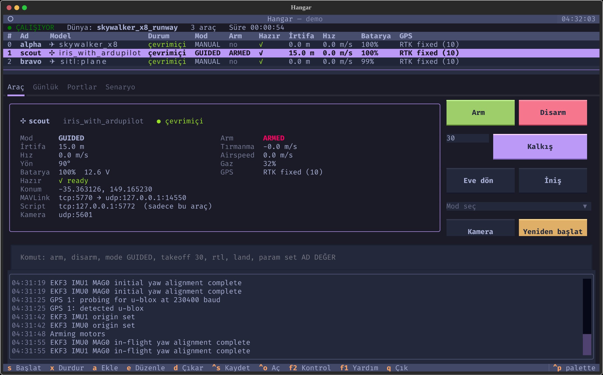
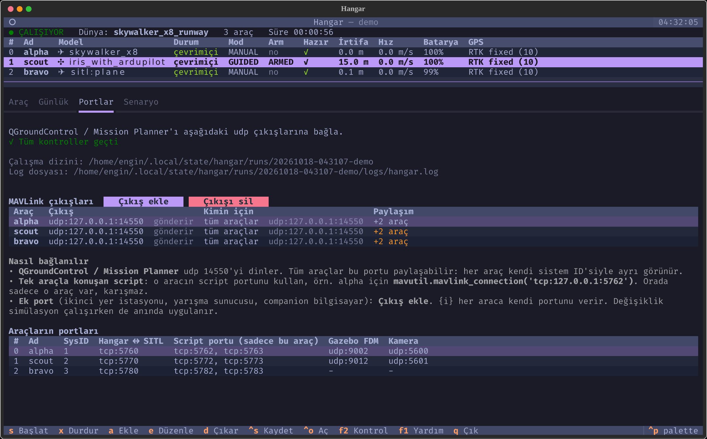
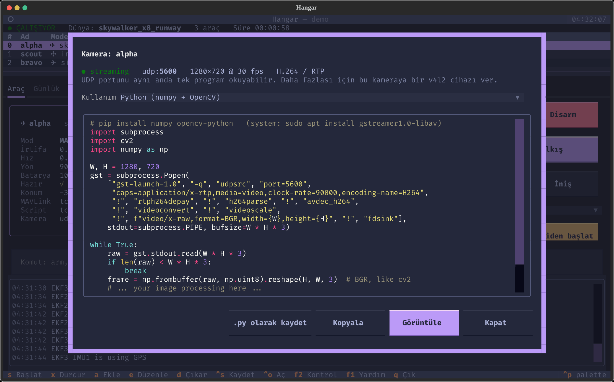
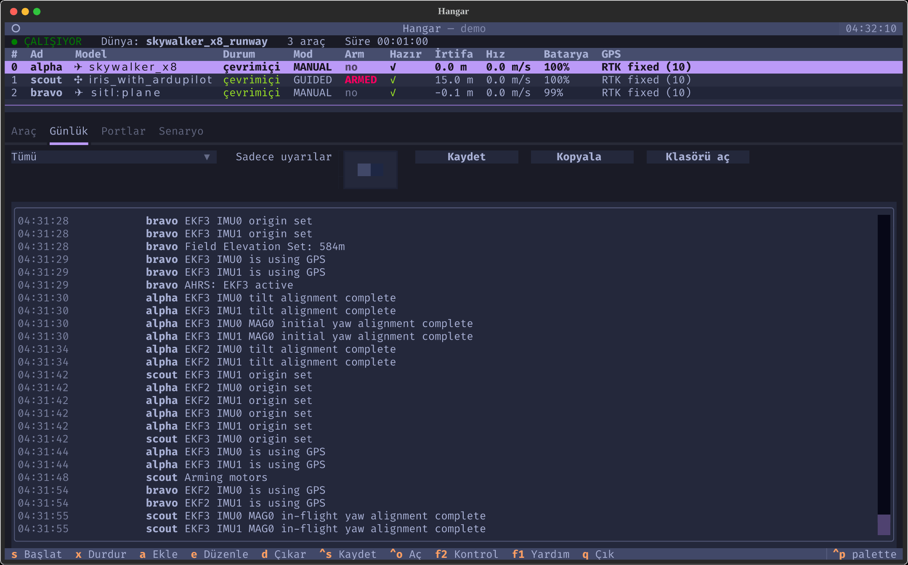
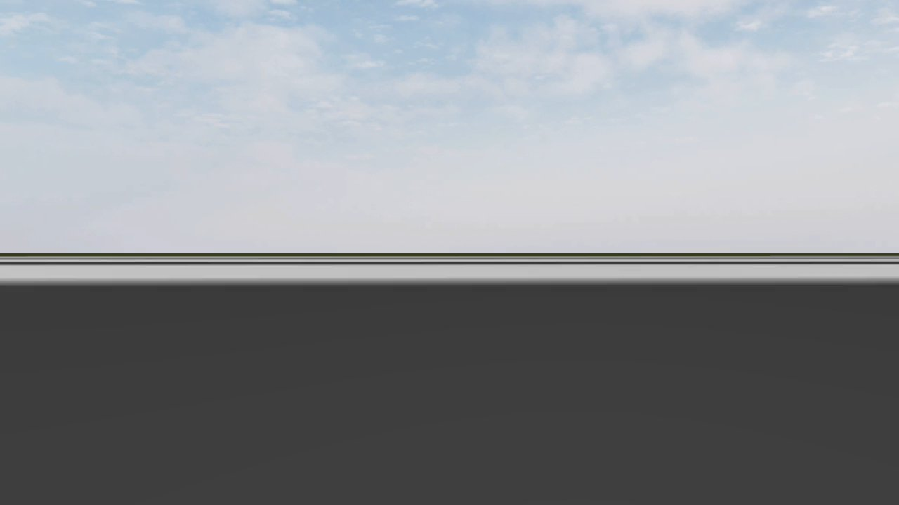
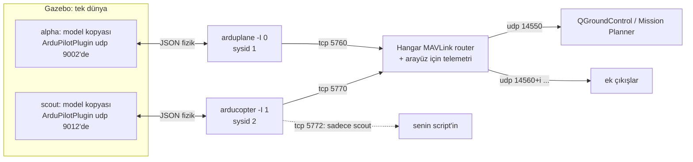
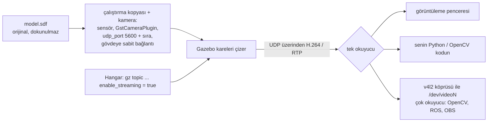

# Hangar

**Tek terminalden çoklu araç ArduPilot SITL + Gazebo.**

Hangar istediğin sayıda ArduPilot aracını (uçak, multikopter, VTOL, kara aracı,
tekne) Gazebo'da ya da ArduPilot'un dahili fiziğiyle başlatır. Araçların
MAVLink trafiğini yer istasyonuna yönlendirir ve bütün filoyu tek bir terminal
arayüzünde gösterir. Tüm portlar tek bir port planından gelir, ekran da onlarca
pencereyle dolmaz.



<sub>Tek terminalde üç araç: burun kameralı bir Gazebo uçağı, aşağı bakan kamerasıyla 15 m'de asılı duran bir Gazebo copter ve ArduPilot'un dahili fiziğiyle uçan bir uçak.</sub>

[English README](README.md)

## Ekran görüntüleri

| Portlar: çıkışlar, paylaşım, araç başına script portları | Kamera: yayın durumu ve hazır kod |
|---|---|
|  |  |
| **Günlük: tüm araçların mesajları, filtrele, kaydet, kopyala** | **Uçağın burun kamerasının gördüğü (OpenCV karesi)** |
|  |  |

## Neden?

Alışılmış çoklu araç kurulumunda her araç için ayrı `sim_vehicle.py` ve ayrı
MAVProxy çalışır, harita için de ayrı bir pencere açılır. Bu düzende yollar
koda gömülüdür, araya `sleep`'ler serpiştirilir, portlar da script'lere
dağılmıştır. Hangar bunların yerine şunları koyar:

- **Tek senaryo dosyası**: dünya, araçlar, konumlar, parametreler ve çıkışlar tek bir YAML'da.
- **Tek port planı**: SITL, Gazebo FDM, kamera ve GCS çıkışlarının hepsi tek yerde hesaplanır. Bir şey başlamadan önce çakışma kontrolü yapılır. Planı görmek için: `hangar ports`.
- **Tek süreç**: SITL'ler arka planda çalışır ve logları dosyaya yazılır. Araç başına MAVProxy yerine dahili bir MAVLink router kullanılır. Durdurunca her şey temizlenir, arkada SITL kalmaz.
- **Tek terminal arayüzü**: her şey başlarken bile donmaz.

## Kurulum

Linux gerekir; Ubuntu 24.04 (x86_64) üzerinde test edildi. Diğer sistemler için: [Desteklenen sistemler](#desteklenen-sistemler).

```bash
curl -fsSL https://raw.githubusercontent.com/Enginar140/hangar/main/install.sh | bash
```

Kurulum her adımdan önce sorar:

1. [uv](https://docs.astral.sh/uv/) ile Hangar'ı kullanıcı dizinine kurar. sudo gerekmez, sistem Python'una dokunulmaz.
2. ArduPilot'un **resmi hazır derlenmiş SITL**'ini indirir: arducopter, arduplane ve ardurover 4.7.2, toplam yaklaşık 21 MB. Birkaç saniye sürer, derleyici gerekmez. Kaynaktan derlemek istersen `--build-ardupilot` seçeneğini kullan.
3. Kopyala butonları için pano aracını (wl-clipboard, xclip) kurar.
4. İstersen Gazebo Harmonic'i, ArduPilot Gazebo eklentisini ve örnek modelleri kurar.
5. Sonunda `hangar doctor` ile kurulumu kontrol eder.

ArduPilot zaten kuruluysa Hangar'a onun yerini göstermen yeterli:

```bash
uv tool install git+https://github.com/Enginar140/hangar
hangar config set ardupilot.dir ~/ardupilot
hangar config add catalog.model_paths ~/SITL_Models/Gazebo/models
hangar config add catalog.world_paths ~/SITL_Models/Gazebo/worlds
hangar config add gazebo.plugin_paths ~/ardupilot_gazebo/build
hangar doctor
```

### İndirilen projelerin lisansları

Hangar MIT lisanslıdır ve içinde sadece kendi kodu vardır. ArduPilot (GPL-3.0),
ardupilot_gazebo (LGPL-3.0) ve SITL_Models (lisans belirtilmemiş) Hangar'ın
içinde **dağıtılmaz**. `hangar sources fetch` her projenin lisansını gösterir,
onay ister ve projeyi sabitlenmiş bir sürümde kendi sunucusundan indirir (hazır SITL için firmware.ardupilot.org, diğerleri için GitHub). Yani
kodu doğrudan kaynağından almış olursun. Hangi commit'lerin indirildiği
`~/.local/share/hangar/sources/lock.json` dosyasında kayıtlıdır.

## Kullanım

```bash
hangar                         # terminal arayüzü (son senaryonu geri yükler)
hangar init                    # quickstart.yaml yazar (Gazebo gerektirmeyen iki araç)
hangar quickstart.yaml         # senaryoyu arayüzde açar
hangar up quickstart.yaml      # arayüzsüz çalıştırır, Ctrl+C ile durur
hangar ports quickstart.yaml   # port planını ve ön kontrolleri gösterir
hangar models / hangar worlds  # başlatılabilecek araçlar ve dünyalar
hangar doctor                  # neyin kurulu olduğunu, neyin eksik olduğunu ve çözümünü gösterir
hangar logs                    # son çalıştırmanın logu (-f canlı izle, -w sadece uyarılar, --list çalıştırmalar)
```

### Loglar

Her çalıştırma, arayüzde görünen her şeyi tek bir dosyaya yazar:
`~/.local/state/hangar/runs/<çalıştırma>/logs/hangar.log`. Buna Hangar'ın
olayları ve araçların tüm MAVLink mesajları (PreArm hataları, mod
değişiklikleri vb.) dahildir. Her SITL'in ve Gazebo'nun ham logu da aynı
klasörde ayrı dosyalarda durur. `runs/latest` her zaman en son çalıştırmayı
gösterir. Günlük sekmesindeki butonlarla görünen logu mevcut filtreyle
**kaydedebilir**, **kopyalayabilir** ya da çalıştırma **klasörünü açabilirsin**.
Terminalden: `hangar logs -f` (canlı), `hangar logs -w` (sadece uyarılar),
`hangar logs --file plane/sitl.log`.

### Arayüz tuşları

| Tuş | İş | Tuş | İş |
|---|---|---|---|
| `s` | başlat | `x` | durdur |
| `a` | araç ekle | `e` / `d` | aracı düzenle / çıkar |
| `1`–`4` | Araç / Günlük / Portlar / Senaryo sekmeleri | `:` | seçili araç için komut satırı |
| `Esc` | filo tablosuna dön | `F2` | sistem kontrolü |
| `ctrl+s` / `ctrl+o` | senaryoyu kaydet / aç | `ctrl+p` | komut paleti (temalar dahil) |
| `m` | ortak harita (MAVProxy) | `q` | çık (simülasyonu durdurur) |

Araç komutları (butonlardan ya da komut satırından): `arm [force]`, `disarm`,
`mode GUIDED` (ya da sadece `GUIDED`), `takeoff 30`, `rtl`, `land`,
`param set AD DEĞER`; harita açıkken `!<MAVProxy komutu>`.

Arayüz Türkçe ve İngilizce destekler ve dili `$LANG`'a göre seçer. Elle
ayarlamak için: `hangar config set language tr`.

## Senaryo dosyası

```yaml
name: iki-ucak
world: skywalker_x8_runway        # sadece dahili fizik kullanacaksan yazma
outputs:                          # her araca uygulanır
  - udp:127.0.0.1:14550           # QGroundControl / Mission Planner
  - udp:127.0.0.1:{15000+i}       # araç başına port; {i} = sıra, {sysid} = MAVLink id
vehicles:
  - model: skywalker_x8
    pose: [0, 0, 0.3, 0, 0, 90]   # x y z roll pitch yaw (m, derece)
    camera:
      v4l2_device: /dev/video2    # burun kamerası -> cv2.VideoCapture('/dev/video2')
  - model: sitl:copter            # dahili fizik, Gazebo gerekmez
    name: scout
    pose: [40, 0, 0]
    params: {SIM_WIND_SPD: 3}
    outputs: ["tcpin:0.0.0.0:{6000+i}"]   # örn. companion bilgisayar buraya bağlanır
```

### Kameralar

Modelinde kamera olmasa bile her Gazebo aracına kamera takılabilir. `camera: true`
yazınca Hangar o çalıştırmanın model kopyasına bir kamera ekler (orijinal
dosyalar değişmez). Görüntü RTP/UDP üzerinden H.264 olarak yayınlanır.
Ayarların hepsi opsiyoneldir:

```yaml
    camera:
      pose: [0, 0, -0.05, 0, 90, 0]   # gövde üzerinde, m/derece; pitch 90 aşağı bakar (varsayılan: burun, ileri)
      width: 1280
      height: 720
      fov: 60                         # yatay görüş açısı, derece
      fps: 30
      v4l2_device: /dev/video2        # opsiyonel: OpenCV/ROS webcam gibi okur
```

Kendi kamerası olan model onu kullanmaya devam eder. Kapatmak için `camera: false` yaz.
Arayüzde araç penceresinden kalite (düşük/orta/yüksek/özel çözünürlük), FPS,
görüş açısı ve yön ayarlanır. Video bit hızı ArduPilot'un kamera eklentisinde
800 kbit/s olarak sabit.

**Başka cihazlara yayın.** Kamera görüntüsü ağdaki başka cihazlara da
gönderilebilir; örneğin görüntü işleme kodunun çalıştığı bir Jetson'a ya da
QGroundControl açık bir laptop'a. İki mod var:

```yaml
    camera:
      stream: relay                     # varsayılan: Hangar yayını kopyalar
      outputs: ["10.205.218.120:5600", "192.168.1.50:{5600+i}", "239.0.0.1:5600"]
```

- `relay` (varsayılan): Kamera Hangar'a gönderir. Hangar her paketi hiç
  değiştirmeden hem bu bilgisayara (`udp 5600 + sıra`) **hem de** `outputs`
  listesindeki her adrese kopyalar. Yeniden kodlama yapılmadığı için ek
  gecikme ya da kalite kaybı olmaz. Hedefler simülasyon çalışırken de
  Portlar sekmesinden (**Görüntü çıkışları**) eklenip silinebilir.
- `direct`: Kamera eklentisi görüntüyü arada aktarıcı olmadan, `outputs`'taki
  tek adrese doğrudan gönderir; ama bu bilgisayar görüntü almaz. Değişiklikler
  bir sonraki başlatmada uygulanır.

Multicast adresi (`239.x.x.x`) ağdaki tüm cihazlara aynı anda ulaşır. Alıcı
tarafta: QGroundControl > Video > UDP h.264 ayarına portu yazmak yeterli; ya
da Kamera penceresindeki kod o cihazda o portla çalışır. Alıcının güvenlik
duvarı bu porta izin vermeli, örn. `sudo ufw allow 5600/udp`. Yayın şifresizdir.

**Kamerayı Python'da kullanmak.** Kamera butonu, o kameranın portuyla
doldurulmuş hazır kod içeren bir pencere açar. Seçenekler: numpy/OpenCV ile
Python, GStreamer'lı OpenCV, v4l2 cihazı ve `gst-launch` komutu. Kodu `.py`
dosyası olarak da kaydedebilirsin. Bağımsız bir örnek:
[`examples/camera_opencv.py`](examples/camera_opencv.py)

```python
from camera_opencv import frames            # examples/camera_opencv.py
for frame in frames(port=5600, width=1280, height=720):
    ...                                      # frame: BGR numpy dizisi, cv2 ile aynı
```

Bu yöntem pip'teki `opencv-python` ile de çalışır; o paketin kendi GStreamer
desteği olmasa bile.

**Başka bir bilgisayarda (Windows dahil):** `pip install opencv-python` ile
[`examples/camera_check.py`](examples/camera_check.py) dosyasını
`python camera_check.py 5600` olarak çalıştır. Script önce paketlerin
gelip gelmediğine bakar; gelmiyorsa olası sebepleri sıralar (yanlış IP,
güvenlik duvarı, Windows'ta "Ortak" ağ). Gelirse görüntüyü OpenCV'nin FFmpeg
desteğiyle ve bir SDP dosyasıyla gösterir; GStreamer gerekmez. UDP portunu aynı anda yalnızca bir program okuyabilir.
Aynı kamerayı birden fazla program okuyacaksa kameraya bir `v4l2_device` ver
ve o cihazı `cv2.VideoCapture('/dev/video2')` ile aç.

### Ortak harita (MAVProxy)

**Harita** butonu (ya da `m`) MAVProxy'nin haritasını ve konsolunu açar.
**Tüm araçlar tek haritada** görünür. Hangar boş bir port bulur, bu portu her
araca geçici bir çıkış olarak ekler ve MAVProxy'yi o porta bağlar. Harita
kapanınca ya da simülasyon durunca ikisi de kaldırılır; harita için port
ayarı yapman gerekmez. Komut satırında `!` ile başlayan her şey, seçili araç
için MAVProxy'ye gider, örneğin `!wp list` ya da `!fence list`. MAVProxy'nin
cevapları Günlük sekmesinde görünür. Arayüzsüz kullanım:
`hangar up senaryo.yaml --map`.

MAVProxy isteğe bağlıdır. Harita'ya ilk bastığında Hangar onu kendi
klasörüne kurmayı önerir: yaklaşık 900 MB (wxPython, OpenCV), sudo gerekmez,
lisansı GPL-3.0. Kurmanın diğer yolları: `hangar sources fetch mavproxy` ya da
`install.sh --mavproxy`. Hazır wxPython paketi Ubuntu 22.04/24.04 x86_64 için
var; başka sistemlerde MAVProxy'yi kendin kurarsan Hangar PATH'teki
`mavproxy.py`'yi kullanır.

### Portlar: yer istasyonu ve script bağlamak

Tüm port ayarları **Portlar** sekmesinde. **Çıkış ekle** ve **Çıkışı sil**
simülasyon çalışırken de kullanılabilir; değişiklik anında uygulanır. Ekleme
penceresi her araç için çıkacak portu önceden gösterir ve çakışan bir çıkışı
eklemene izin vermez.

- **QGroundControl / Mission Planner** udp 14550'yi dinler. Varsayılan olarak
  tüm araçlar bu portu paylaşır; bu programlar her aracı kendi sistem ID'siyle
  ayrı gösterir.
- **Tek araçla konuşan script** o aracın kendi script portuna bağlanır:
  `tcp:127.0.0.1:5762 + 10*i`. O porttan başka araç konuşmaz, araçlar karışmaz.
  Örnek: [`examples/mavlink_script.py`](examples/mavlink_script.py)
- **Ek port** (ikinci yer istasyonu, yarışma sunucusu, companion bilgisayar):
  çıkış ekle. `{i}` her araca ayrı port verir, örn. `udp:127.0.0.1:{14560+i}`.

### Port düzeni

| | araç 0 | araç 1 | araç *i* |
|---|---|---|---|
| MAVLink (SITL serial0) | tcp 5760 | tcp 5770 | 5760 + 10*i* |
| Script portları (sadece o araç) | tcp 5762, 5763 | tcp 5772, 5773 | 5762 + 10*i*, 5763 + 10*i* |
| Gazebo ↔ SITL | udp 9002 | udp 9012 | 9002 + 10*i* |
| Kamera, bu bilgisayar (RTP H.264) | udp 5600 | udp 5601 | 5600 + *i* |
| Kamera, eklenti → Hangar aktarıcısı | udp 5700 | udp 5701 | 5700 + *i* |
| MAVLink sistem id | 1 | 2 | *i* + 1 |

## Kendi aracını eklemek

`model.sdf` dosyasında `ArduPilotPlugin` bulunan her Gazebo modeli
`hangar models` listesinde görünür. Hangar'a modelin ne olduğunu söylemek için
modelin yanına bir `hangar.yaml` koy:

```yaml
type: plane                 # copter | plane | rover | boat
params: [benim_ucagim.param]
camera_pose: [0.5, 0, 0.05, 0, 0, 0]   # opsiyonel: `camera: true` kamerayı buraya takar
```

Sonra model klasörünü ekle: `hangar config add catalog.model_paths /yol/models`.

## Hazır dünyalar

[hangar-worlds](https://github.com/Enginar140/hangar-worlds) üç dünya ekler:
400 m pistli bir **havaalanı**, hedefleri ve hava savunma bölgeleri olan 1 km'lik
bir **görev alanı** ve küçük bir **kasaba**. Kurmak için:
`hangar sources fetch hangar_worlds`. Kurulum script'i de Gazebo ile
birlikte bu paketi önerir.

| airfield | mission_arena | town |
|---|---|---|
|  |  |  |

## Gerçek yerlerden dünyalar

```bash
hangar world create --lat 39.88 --lon 33.23 --size 3000 --name ankara_hills
```

Senaryo sekmesindeki **Gerçek bir yerden dünya oluştur** butonu da aynı işi
yapar. [hangar-earth](https://github.com/Enginar140/hangar-earth), dünyanın
herhangi bir noktası için gerçek arazisi (Copernicus DEM, 30 m) ve uydu
görüntüsüyle (Sentinel-2, 10 m) bir Gazebo dünyası üretir; yaklaşık 15 saniye
sürer. Hangar onu ilk kullanımda, lisansını gösterip onay alarak kurar. Dünya
gerçek koordinatlarında durur, araçlar da orada başlar: GPS, QGroundControl ve
MAVProxy haritası gerçek yeri gösterir. Araçlar `pose` konumunda yere konur;
yani `z` arazinin üstündeki yüksekliktir.

OpenStreetMap **binaları** da gelir ve fizikte katıdır; istemezsen
`--no-buildings` ile kapatabilirsin. Daha keskin bir dünya için kendi verini
verebilirsin: `--dem arazi.tif` ve `--imagery ortofoto.tif` (herhangi bir
koordinat sistemi, örneğin bir drone haritalamasından) ya da kullanım hakkın
olan bir karo servisi için `--imagery-url`. Senaryo sekmesindeki pencerede de
binalar anahtarı ve bu iki dosya alanı var.


## Desteklenen sistemler

Hangar **Linux** üzerinde çalışır. Kurulum script'i başka sistemlerde durur.

| Sistem | Durum |
|---|---|
| **Ubuntu 24.04, x86_64** | **Uçtan uca test edildi**: dahili fizik, Gazebo Harmonic 8.15, kameralar, kurulum |
| Ubuntu 22.04, x86_64 | Kurulum script'i destekliyor (Gazebo Harmonic paketleri var), henüz test edilmedi |
| Diğer Linux dağıtımları, x86_64 | Hangar ve dahili fizikli araçlar çalışmalı; Gazebo'yu kendin kurman gerekir. Kurulum script'i uyarıp onay ister. Test edilmedi |
| ARM 32-bit (armv7) | ArduPilot bunun için hazır SITL yayınlıyor. Test edilmedi |
| ARM 64-bit (Jetson, Raspberry Pi OS 64-bit) | ArduPilot'un hazır SITL derlemesi yok; `--build-ardupilot` ile derlenmeli. Test edilmedi |
| Windows (WSL2 + Ubuntu) | Test edilmedi. SITL'in çalışması beklenir, Gazebo WSLg ile çalışabilir; v4l2loopback yok |
| macOS | Desteklenmiyor: hazır SITL yok, kurulum script'i sadece Linux için |

Python 3.11, 3.12 ve 3.13 CI'da test ediliyor. Kurulum Python 3.12'yi uv ile
getirdiği için sistemdeki Python sürümü önemli değil. Gazebo için bir GPU
olması iyi olur; `headless: true` ile kamera kullanmak EGL (penceresiz çizim)
gerektirir.

## Nasıl çalışır

### Aynı anda birden fazla araç

Her araç, `-I <sıra>` ile başlatılan ayrı bir ArduPilot SITL sürecidir.
ArduPilot bir kopyanın tüm portlarını `10 × sıra` kadar kaydırır; Hangar'ın
port planı bu kurala dayanır. Her araç ayrıca kendi MAVLink sistem ID'sini
(`sıra + 1`) ve kendi çalışma klasörünü (eeprom, loglar) alır.



- **Gazebo araçları.** Bir Gazebo eklentisine her `<include>` için farklı port
  verilemez. Bu yüzden Hangar her aracın modelini çalıştırma klasörüne
  kopyalar. Kopya benzersiz bir ad ve kendi FDM portunu (`9002 + 10 × sıra`)
  alır. Mesh ve malzemeler orijinallere giden kısayollardır (symlink);
  orijinal dosyalar hiç değişmez. Tüm kopyalar üretilen tek bir dünyaya
  konur. Dünyanın kendi araçları çıkarılır, böylece neyin uçacağına sadece
  senaryo karar verir. Hangar, SITL'leri başlatmadan önce Gazebo'nun her
  aracın FDM portunu açmasını bekler.
- **Dahili fizikli araçlar** Gazebo gerektirmez. Başlangıç konumları (home)
  `pose` değerine göre kaydırılır, böylece hepsi aynı noktada doğmaz.
- **MAVLink.** Hangar araç başına bir MAVProxy çalıştırmaz. Onun yerine her
  SITL'in ilk portuna (`tcp 5760 + 10 × sıra`) bağlanır ve trafiği her iki
  yönde tüm çıkışlara iletir. Her aracın kendi sistem ID'si olduğu için
  QGroundControl ve Mission Planner udp 14550'yi paylaşabilir. Script'ler
  aracın boştaki SITL portlarını (`5762/5763 + 10 × sıra`) kullanabilir;
  o portlarda sadece o araç konuşur.
- **Süreçler.** SITL'ler, Gazebo ve kamera yardımcıları kendi süreç
  gruplarında çalışır, çıktıları log dosyalarına gider. Durdurunca her
  grubun tamamına sinyal gönderilir; Hangar kapandıktan sonra arkada hiçbir
  şey kalmaz.

### Kameralar

Kameralar ArduPilot'un `GstCameraPlugin` eklentisini (ardupilot_gazebo'nun
parçası) kullanır. Bu eklenti çizilen görüntüyü H.264 olarak kodlar ve UDP
üzerinden RTP olarak gönderir.



1. `camera: true` yazılmışsa ve modelde kamera yoksa, Hangar modelin
   çalıştırma kopyasına bir kamera ekler. Eklenen parçalar: küçük bir gövde;
   istenen çözünürlük, görüş açısı ve FPS ile bir `camera` sensörü;
   `udp 5600 + sıra` portuna gönderen `GstCameraPlugin`; ve sabit bir
   bağlantı (joint). Bağlantı `base_link`'e yapılır. Araç gövdesini başka bir
   modelden alıyorsa (iris ve zephyr böyle) o modelin gövdesine yapılır.
   Kameranın konumu sırasıyla şuralardan gelir: `camera.pose`, Hangar'ın araç
   listesindeki `camera_pose` (SITL_Models uçaklarının burnu) ya da gövdenin
   biraz önündeki varsayılan nokta.
2. Modelin kendi kamerası varsa Hangar sadece portunu değiştirir. Senaryoda
   çözünürlük ya da FPS verilmişse onları da uygular.
3. Dünyada Gazebo'nun Sensors sistemi yoksa eklenir; o olmadan kameralar
   görüntü üretmez.
4. Gazebo açılınca Hangar kameranın `enable_streaming` konusunu
   (`gz topic -l` ile) bulur ve açar. Bundan sonra görüntü UDP portundadır;
   Kamera penceresi onu okuyacak kodu gösterir.
